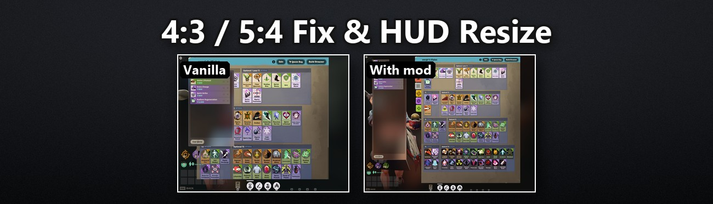

# 4:3 / 5:4 Fix & HUD Resize



Play Deadlock on a 4:3, 5:4 or other narrow screen with a complete, un-stretched HUD, and pick the
HUD size on any screen. Only the interface changes; gameplay, resolution and field of view stay as
they are.

Download: [GameBanana](https://gamebanana.com/mods/728787) · [GitHub releases](https://github.com/Vergir/deadlock-4x3-fix-hud-resize/releases/latest)

## Features

- **Narrow screens (4:3, 5:4, 9:8, 1:1 ...):** the HUD is no longer stretched and is laid out like a
  16:9 screen of the same width, so nothing falls off the edge: the health bar is back (vanilla
  pushes it out of view) and the shop's Quick Buy column no longer covers the items.
- **HUD size:** eleven versions from 0.5 to 1.5. Size 1.0 is the vanilla size on 16:9 and 16:10, so
  there it changes nothing; the other sizes shrink or enlarge the whole HUD and the menus.
- **Crosshair:** shows the real bullet spread at every HUD size. On narrow screens it is round;
  vanilla stretches it there and shows the spread about twice as wide as it is.
- **Shop:** stays at its normal size when the HUD is larger, so it always fits; Quick Buy, souls,
  items and the build editor take the shop's size while it is open.
- **Menus:** keep the game's own size and 4:3 layout, only un-stretched (times the HUD size). The
  screens that break at that size are fitted instead: the shop and its build editor, Watch Matches
  (its 2 x 2 grid), the player page, the post-match scoreboard and graphs. Hero select shows the whole
  hero, with larger hero cards.

## What it does not do

- It does not change resolution or field of view. A narrow resolution is set with Steam launch
  options, because the game's video settings only offer 16:9, 16:10 and 21:9.
- It does not add, hide or reveal anything: every element is the game's own, only scaled and placed.

## Installation

With **Deadlock Mod Manager**: install the mod from its GameBanana page and pick one size.

Manually:

1. Download one size, e.g. `deadlock-4x3-fix-hud-resize-v1.1.0-size1.0.zip`. Size 1.0 is the plain fix; pick another
   size for a smaller or larger HUD.
2. Copy `pak01_dir.vpk` from the zip into `Deadlock\game\citadel\addons\` (create the folder if needed).
   If a `pak01_dir.vpk` from another mod is already there, rename this one to the next free number
   (`pak02_dir.vpk`, ...).
3. Open `Deadlock\game\citadel\gameinfo.gi` in a text editor and make the start of
   *FileSystem > SearchPaths* read:
   ```
   Mod      citadel
   Write    citadel
   Game     citadel/addons
   Game     citadel
   Game     core
   ```
4. Narrow screens only: in Steam, *Deadlock > Properties > General > Launch Options*, enter your
   resolution, e.g. `-w 1280 -h 1024`.
5. Restart Deadlock.

**Uninstall:** delete the vpk. The `gameinfo.gi` lines are the ones every addon uses and can stay.

## Compatibility

- **Game version:** tested with Deadlock build 6819 (October 24, 2026) on Windows.
- **After a game update:** the mod replaces three small UI files (`hud_data_feed.xml`,
  `citadel_dashboard_footer_bar.xml`, `npc_icons.css`). If an update changes one of them, the HUD
  falls back to vanilla, or the game stops at launch with an error naming the file; delete the vpk
  and check for a new version. Updates also reset `gameinfo.gi`; add the lines again (the mod
  manager does it for you).
- **Online play:** only interface files change, as with any HUD mod; no game code, memory or network
  traffic is touched.
- **Other mods:** other 4:3 / 5:4 HUD fixes replace the same HUD, mostly with older copies of the
  game's files; use only one. Mods that replace one of the three files above conflict with this one.

## Known issues

- At size 1.3 and above on a narrow screen a few panels overlap slightly.
- Below size 1.0 the bottom corners of the HUD move toward the middle: the game keeps that group in
  a centered 1920-unit band, as it does on ultrawide screens.
- 21:9 is tested at size 1.0 only.

## How it works

On a screen narrower than 16:10 the game lays the interface out on a 1440x1080 canvas and stretches
it to the screen, so everything is too tall, and panels placed as "centered, then offset by a fixed
amount" fall off the narrow canvas. A small script (`src/panorama/scripts/narrowhud.vts`), loaded by
two tiny layouts the game always shows, measures the real stretch and rescales the interface's
top-level containers: the HUD uniform and as wide as the 16:9 layout expects, the menus uniform at the
game's own canvas width, both times the chosen size. On 16:9, 16:10 and 21:9 it keeps the game's own
canvas. The shop, a few menu screens built wider than 4:3, the health bar and the crosshair get their
own corrections; `npc_icons.css` carries the one CSS rule (the health bar position).

## Building from source

```bash
pip install vpk
python build.py --ui-size 1.0     # -> build/mod/pak01_dir.vpk
python release.py 1.0.2           # all sizes as zips named by version -> build/dist/
```

`--test` shows a small "resize hud: ON" marker and prints the measured values to the game console
(launch with `-condebug` to get them in `game/citadel/console.log`). `--hud-aspect W:H` confines the
HUD to a centered W:H region and `--fov-aspect` sizes the crosshair for a custom `r_aspectratio`;
both are for personal builds. `install.py` copies a build into the game and edits `gameinfo.gi`;
`uninstall.py` reverts it for comparing with vanilla. Their game and Steam paths are the author's,
change them at the top of `install.py`. `install.py --loose` is for development: the script goes in
as a loose file and a running game picks up each new install within a second (hot reload).
Optional defaults can live in a git-ignored `local_settings.json` (`ui_size`, `hud_aspect`,
`gameinfo_convars`, and `launch_options`: named Steam launch options that `--launch NAME` on
install / uninstall switches to, restarting Steam because it keeps them in memory).

## Source and support

Code: this repository · License: MIT

Problems: open a GitHub issue or comment on the GameBanana page, and include your resolution, the
size you installed and a screenshot.
